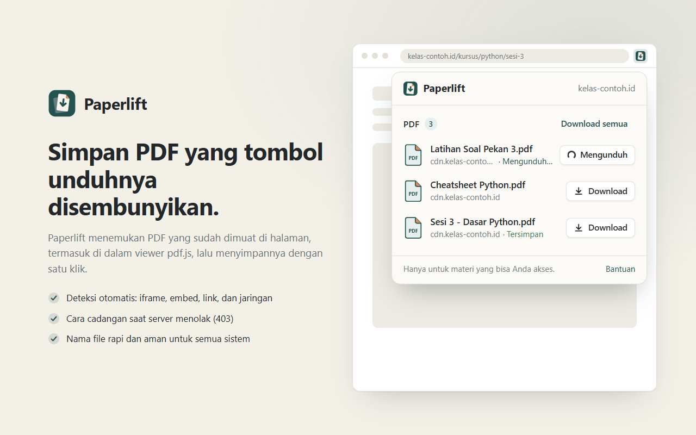
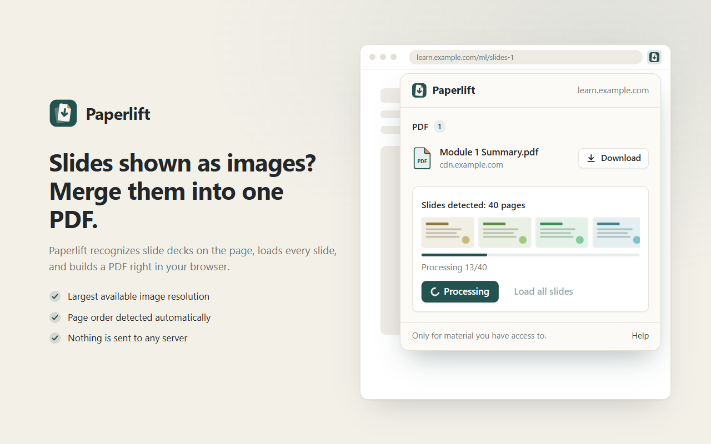
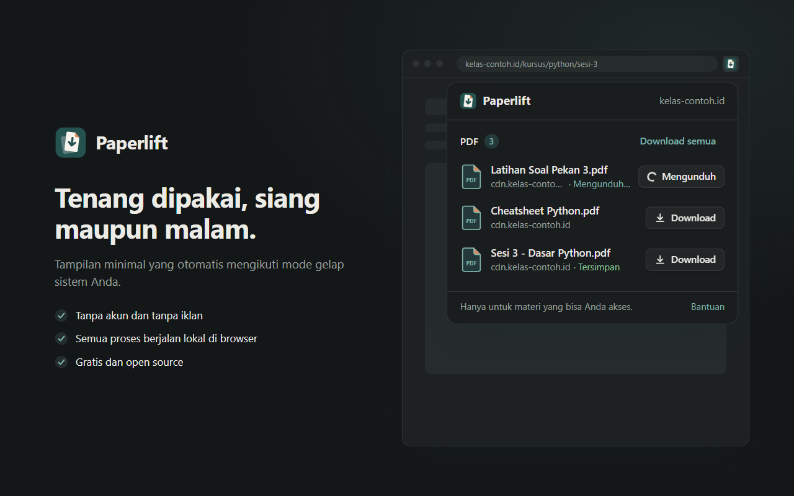

<p align="center"></p>

<h1 align="center">Paperlift</h1>

<p align="center">
  <b>Save PDFs and image-based slides from any web page, in one click.</b><br>
  A lightweight Chrome extension (Manifest V3). No account, no tracking, everything runs locally.
</p>

<p align="center">
  <a href="https://github.com/hubble99/paperlift-extension/releases/latest"></a>
  
  
  
  <a href="LICENSE"></a>
</p>

<p align="center"></p>

Some sites show a PDF on the page but hide the download button. A common example is an
online course player that displays lecture notes inside an embedded pdf.js viewer. The file
is already loaded in your browser, but there's no easy way to save it.

Paperlift finds those PDFs and lets you save them with one click. It can also merge slides
shown as a series of images into a single PDF.

> [!IMPORTANT]
> Paperlift is for material you already have legitimate access to, for personal use.
> It does **not** break DRM or encryption, and it can't download anything your browser
> hasn't been allowed to load.

## Contents

- [Features](#features)
- [Installation](#installation)
- [How to use](#how-to-use)
- [Updating and uninstalling](#updating-and-uninstalling)
- [How it works](#how-it-works)
- [Permissions](#permissions)
- [Privacy](#privacy)
- [Limitations](#limitations)
- [Troubleshooting](#troubleshooting)
- [Development](#development)
- [Credits](#credits)
- [License](#license)

## Features

### PDF detection
- **pdf.js viewers.** Reads the real file URL from the `?file=` parameter of embedded
  pdf.js viewers (iframes or full pages), including ones hosted on another domain or CDN.
- **`<embed>` and `<object>`** elements that show a PDF.
- **Links to `.pdf` files** on the page, including links with a `download` attribute.
- **Network detection.** Any response in the tab with `Content-Type: application/pdf` is
  picked up, even if it never appears in the page markup.
- **Works in every frame.** Nested iframes are scanned as well.
- **No duplicates.** The same file found in several ways is listed once.
- **Badge counter.** The toolbar icon shows how many PDFs were found on the current tab.
- **Per-tab and temporary.** The list is cleared when you close the tab or navigate away.

### Downloading
- **One-click download** for a single file, or **Download all** when there are two or more.
- **Automatic fallback when the server refuses** (for example `403 Forbidden`, or an HTML
  error page instead of a PDF). Paperlift then fetches the file from inside the frame that
  originally loaded it, using the same login session and referrer as the page. See
  [How it works](#how-it-works).
- **Content check.** A file is only saved if it really is a PDF. Fake HTML "PDFs" are
  removed and retried another way.
- **Clean file names.** The name comes from the server's `Content-Disposition` header,
  then from the URL, then from the page title. Characters that aren't allowed on Windows,
  macOS or Linux are removed, and so are reserved names like `CON`.
- **Keeps running in the background.** You can close the popup while a download is in progress.

### Image slides to PDF
- **Slide deck detection.** Paperlift recognizes a deck when the page shows three or more
  large images or canvases in a row with the same aspect ratio. Logos, avatars, icons and
  photo galleries are ignored.
- **Correct page order.** Slides are ordered by `data-page`-style attributes, "Slide N"
  labels, or numbers in the file names. If none of these is reliable, page order is used.
- **Best available resolution.** Picks the largest image from `srcset` and lazy-load
  attributes (`data-src`, `data-original`, …).
- **Load all slides.** Auto-scrolls the page so lazy-loaded slides appear. It stops when no
  new slides show up or after 30 seconds, then returns you to where you were.
- **Merge into PDF** with live progress (`Processing 12/40`). Each slide becomes one page
  at its original size. JPEG and PNG are embedded as-is. WebP, AVIF, GIF, BMP and SVG are
  converted automatically.
- **Canvas support.** Slides drawn on `<canvas>` are included. Canvases the browser won't
  let extensions read are skipped, and Paperlift tells you which page numbers were skipped.

### Interface
- Small, calm popup with instant visual feedback on every click, and light and dark mode.
- Respects your system's *reduce motion* setting.

<p align="center">
  
  
</p>

## Installation

Paperlift isn't on the Chrome Web Store. You install it manually, which takes about a
minute. It works in **Google Chrome 116 or newer** and in other Chromium browsers such as
Microsoft Edge, Brave, Opera and Vivaldi.

### Step 1: Download Paperlift

Choose **one** of these:

- **Option A (recommended): from Releases**
  1. Go to the [latest release](https://github.com/hubble99/paperlift-extension/releases/latest).
  2. Under **Assets**, download `paperlift-<version>.zip`.

- **Option B: the full source as a ZIP**
  1. On this repository's main page, click the green **Code** button.
  2. Click **Download ZIP**.

- **Option C: with Git**
  ```bash
  git clone https://github.com/hubble99/paperlift-extension.git
  ```

### Step 2: Unzip it to a permanent folder

1. Right-click the downloaded ZIP and choose **Extract All…** (Windows), or double-click it
   (macOS).
2. Move the extracted folder somewhere it can stay, for example `Documents\Paperlift`.

> [!WARNING]
> Don't delete or move this folder after installing. Chrome loads the extension from it
> every time it starts.

Open the folder and check that `manifest.json` is directly inside it. With Option B the
folder is called `paperlift-extension-main`.

### Step 3: Load it into Chrome

1. Open a new tab and go to **`chrome://extensions`**.
   (Edge: `edge://extensions`, Brave: `brave://extensions`.)
2. Turn on **Developer mode** with the toggle in the top-right corner.
3. Click **Load unpacked**.
4. Select the folder from Step 2, the one that contains `manifest.json`, and click
   **Select Folder**.
5. **Paperlift** now appears in your list of extensions.

### Step 4: Pin the icon (optional, recommended)

Click the puzzle-piece icon 🧩 in the Chrome toolbar, then click the pin 📌 next to
**Paperlift**. The icon and its counter badge now stay visible.

### Step 5: Reload your open tabs

Tabs that were already open before you installed Paperlift can't be scanned until you
reload them (`F5` or `Ctrl+R`, or `Cmd+R` on macOS).

That's it. Open a page with a PDF and click the Paperlift icon.

## How to use

### Saving PDFs

1. Open the page that shows the PDF, for example a course lesson with lecture notes.
   If the player only loads the file when you open the material, open it first.
2. The number on the Paperlift icon shows how many PDFs were found.
3. Click the icon. The popup lists every PDF with its file name and source website.
4. Click **Download** next to a file, or **Download semua** (*Download all*) to save every file.
5. The file is saved to your normal Downloads folder. The button briefly shows
   **Tersimpan** (*Saved*) ✓.

If the first attempt is refused, you'll see *Mencoba lewat halaman…* (*Trying via the
page…*) while Paperlift switches to the fallback method automatically. You don't need to do
anything.

### Merging image slides into one PDF

When a page shows a presentation as a series of images, the popup displays
**Slide terdeteksi: N halaman** (*Slides detected: N pages*) with a few thumbnails.

1. If the page loads slides as you scroll, click **Muat semua slide** (*Load all slides*)
   first. Wait until it finishes (30 seconds at most), then reopen the popup to see the new
   count.
2. Click **Gabung jadi PDF** (*Merge into PDF*).
3. Watch the progress (`Memproses 12/40`). You can close the popup, because the work
   continues in the background.
4. The PDF is saved to your Downloads folder, named after the page title.

### Interface language

The popup is currently in **Indonesian**. Here's what each label means:

| Popup label | Meaning |
|---|---|
| Download | Download this file |
| Download semua | Download all |
| Gabung jadi PDF | Merge into PDF |
| Muat semua slide | Load all slides |
| Slide terdeteksi: *N* halaman | Slides detected: *N* pages |
| Mengunduh… | Downloading… |
| Mencoba lewat halaman… | Trying via the page (fallback)… |
| Tersimpan | Saved |
| Gagal: … | Failed: … (followed by the reason) |
| Coba lagi | Try again |
| Memproses 12/40 | Processing 12 of 40 |
| Tidak ada PDF terdeteksi | No PDFs detected |
| Halaman ini tidak bisa dipindai | This page can't be scanned (for example `chrome://` pages) |
| Hanya untuk materi yang bisa Anda akses. | Only for material you have access to. |

## Updating and uninstalling

**Update**
1. Download the new version (see [Step 1](#step-1-download-paperlift)).
2. Replace the contents of your Paperlift folder with the new files. Keep the same folder location.
3. Go to `chrome://extensions` and click the reload icon ↻ on the Paperlift card.
4. Reload any open tabs you want to use it on.

If you used Git, run `git pull` inside the folder instead of steps 1–2.

**Uninstall**
Go to `chrome://extensions`, click **Remove** on the Paperlift card, then delete the folder.

## How it works

Paperlift tries up to three ways to save a PDF and stops at the first one that works:

1. **Direct download.** It asks Chrome to download the file URL normally. Your cookies are
   sent, just like clicking a link.
2. **Through the page.** If the server refuses (`403`) or returns an HTML page instead of a
   PDF, the file is fetched from inside the frame that loaded it. The request then looks
   exactly like the viewer's own request: same cookies, same referrer. The bytes are passed
   to the extension and saved.
3. **Through the extension.** As a last resort, the file is fetched from the extension
   itself. Cross-origin (CORS) rules don't apply there, but the page's referrer isn't sent.

For slides, each image is collected at its best resolution. Paperlift reads it from the
page, from a canvas, or through the extension when the page isn't allowed to read it.
Everything is then assembled into a PDF locally with [pdf-lib](https://pdf-lib.js.org/).

<details>
<summary>Glossary of technical terms</summary>

| Term | In plain words |
|---|---|
| **pdf.js** | A PDF viewer that runs inside web pages; many sites use it |
| **iframe** | A small web page embedded inside another page |
| **Referrer** | A header that tells the server which page a request came from. Some servers refuse requests without the "right" one |
| **403 Forbidden** | The server refused to hand over the file |
| **CORS** | Browser rules that stop a page from reading files from another domain |
| **Tainted canvas** | A canvas that contains an image from another domain without permission, so its pixels can't be read |
| **Lazy-loading** | Images that only load when you scroll near them |
| **Service worker** | The part of the extension that runs in the background |
| **Offscreen document** | A hidden extension page used to build files before saving them |

</details>

## Permissions

Chrome will show these permissions when you install. Here's why each one is needed:

| Permission | Why |
|---|---|
| `storage` | Keeps the list of detected PDFs and slides for each tab in session memory. It's cleared when the browser closes. |
| `webRequest` | **Observes** response headers to recognize PDF files. It never blocks or changes any request. |
| `downloads` | Saves files to your Downloads folder and checks whether each download succeeded. |
| `offscreen` | Builds the file (for example a merged slide PDF) before handing it to Chrome. The background worker can't do this itself. |
| Access to all sites | PDFs and slide images can come from any domain, often a CDN separate from the site you're on. |

Paperlift doesn't use the `tabs`, `scripting`, `history` or `cookies` permissions.

## Privacy

No account, no ads, no analytics, and no remote code. Nothing is sent to the developer or to
any third party. Detected URLs are kept only in temporary session memory, and downloaded
files go straight from the original website to your computer.
Full policy: [PRIVACY.md](PRIVACY.md).

## Limitations

- **Viewers that never send a complete PDF aren't supported**, for example Scribd,
  FlipHTML5, Issuu, or players that stream pages as tiles. Slide merging only works when each
  page is one complete image or canvas.
- **No DRM or encryption removal.** Encrypted PDFs are saved exactly as the server sends them.
- **Merged slide PDFs contain images.** Their text can't be selected, searched or edited.
- **Some canvases can't be read** (tainted, see the glossary above). Those pages are skipped
  and listed. WebGL canvases may come out blank.
- **Click-through carousels.** Slides that only load when you press "Next" aren't loaded by
  *Load all slides*. Click through to the last slide manually first.
- **Special URLs aren't detected.** `blob:` and `data:` URLs inside a viewer's `?file=`
  parameter are skipped.
- **Pages extensions can't access.** Paperlift can't scan `chrome://` pages or the Chrome
  Web Store. Local `file://` pages only work if you enable *Allow access to file URLs* on the
  extension's details page.

## Troubleshooting

<details>
<summary><b>"Manifest file is missing or unreadable" when loading</b></summary>

You selected the wrong folder. Pick the folder that has `manifest.json` **directly** inside
it. After unzipping there is sometimes an extra folder level, so open it and select the
inner folder.
</details>

<details>
<summary><b>The popup says "Tidak ada PDF terdeteksi" (No PDFs detected)</b></summary>

- Reload the page. This is required after installing or reloading the extension.
- Open the PDF in the page first. Some players only load the file when you open the lesson.
- If the PDF loaded before Paperlift was active, the network detector missed it. Reload the
  page.
</details>

<details>
<summary><b>"Gagal: server menolak akses (403)" (Failed: access denied)</b></summary>

1. Make sure you're still logged in and the PDF displays normally. Reload the page and try again.
2. Paperlift already retries through the page automatically. If it still fails:
   - The link may be a signed URL that has expired, which is common on CDNs. Reload the
     page so the viewer gets a fresh link, then click **Download** right away.
   - The server may require something other than cookies and referrer, such as a special
     token header. Sites like this aren't supported.
3. For details, go to `chrome://extensions` → Paperlift → **service worker** (under
   *Inspect views*) → **Console**.
</details>

<details>
<summary><b>"Gagal: diblokir server (CORS/jaringan)" (Failed: blocked by the server)</b></summary>

Neither the page nor the extension was allowed to read the file. Try opening the viewer on
its own: right-click inside the PDF viewer, open the frame in a new tab, then use Paperlift
there.
</details>

<details>
<summary><b>Slides aren't detected</b></summary>

- Slides must be shown reasonably large (at least 300 px wide), and there must be at least 3
  of them. Try making the window bigger.
- Images separated by paragraphs of text are treated as an article or gallery, not a deck.
- Click **Muat semua slide** (*Load all slides*), then reopen the popup.
</details>

<details>
<summary><b>The extension disappeared or shows an error after restarting Chrome</b></summary>

The installation folder was probably moved, renamed or deleted. Put it back, or install
again from [Step 3](#step-3-load-it-into-chrome).
</details>

Still stuck? [Open an issue](https://github.com/hubble99/paperlift-extension/issues).
Include the website type (not private links), what you clicked, and the error text.

## Development

Plain JavaScript with no framework, no build step and no npm dependencies. Edit a file,
click ↻ on `chrome://extensions`, then reload the tab.

```
manifest.json                Extension configuration (Manifest V3)
background/service-worker.js Per-tab state, network detection, badge, 3-step download, slide merging
content/content.js           Runs in every frame: finds PDFs, detects slide decks, fetches from the page
offscreen/                   Hidden page: builds blobs, converts images, runs pdf-lib
popup/                       The popup UI (HTML, CSS, JS)
lib/shared.js                Helpers shared by the worker and popup (file names, merging lists)
vendor/pdf-lib.min.js        pdf-lib 1.17.1, bundled (MIT)
icons/  brand/               Rendered icons and their SVG sources
store/                       Screenshots and promo image (rendered from store/src/)
tests/                       Local test server and test pages
tools/                       Packaging and asset rendering scripts (not part of the extension)
docs/                        Manual test checklist, Chrome Web Store notes
```

| Command | What it does |
|---|---|
| `python tests/server.py` | Starts a local test site at http://127.0.0.1:8000/ with pdf.js iframes, protected (403) files, odd file names and slide decks. See [docs/TESTING.md](docs/TESTING.md). |
| `python tools/package.py` | Builds `dist/paperlift-<version>.zip` with only the runtime files. This is the ZIP attached to releases. |
| `node tools/render-assets.mjs` | Renders the icons, screenshots and promo image from `brand/*.svg` with headless Chrome. On Node 20, add `--experimental-websocket`. |

**Making a release:** bump `version` in `manifest.json`, run `python tools/package.py`,
then create a GitHub release and attach the ZIP from `dist/`.

## Credits

- [pdf-lib](https://pdf-lib.js.org/) 1.17.1 by Andrew Dillon, MIT License
  (see [vendor/pdf-lib.LICENSE.md](vendor/pdf-lib.LICENSE.md)).
- Logo and icons: original artwork made for Paperlift (`brand/`).

## License

Paperlift is released under the [MIT License](LICENSE). You're free to use, modify and
share it, as long as the copyright notice is kept. It comes with no warranty.
